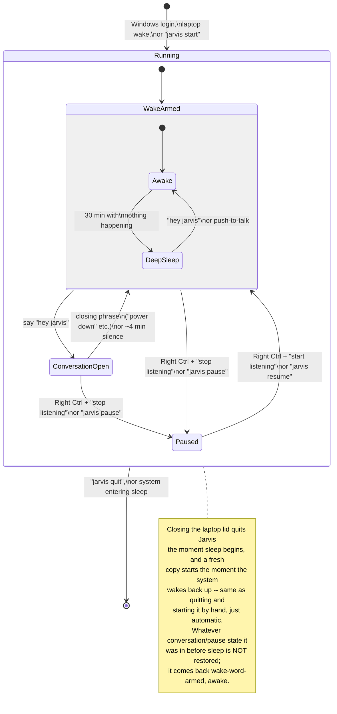

# Jarvis -- User Guide

A walkthrough of how Jarvis behaves day to day: when it starts, what it's
doing at each stage, what you can actually say to it, the different "off"
states and what each one means, and how to control it. Written from what
you'd actually experience -- implementation details live in `README.md`
instead.

## 1. Starting up

Jarvis starts **automatically every time you log into Windows** -- you
don't need to launch anything yourself. A full-screen console window
opens with its own look (dark background, the Mark III suit's red and
gold mixed with the original cyan HUD accents), showing a running
commentary of everything it hears and does as it happens. You can
minimize or un-fullscreen it (the usual Windows shortcuts work), but
leave it running -- closing that window's own **X** button also stops
Jarvis, though less cleanly than the quit command (section 7): Windows
just ends the process directly rather than it shutting itself down in
an orderly way. No lasting harm either way, but prefer `jarvis quit`
when you can.

On startup, it spends several seconds loading (transcription model, the
wake-word listener, the command-matching model), visible as a few
status lines in that window. During that handful of seconds it isn't
listening for "hey jarvis" yet. Once loaded, it's live -- and says so
out loud ("Online and at your service, sir").

It also starts the same way after your laptop wakes from sleep -- see
the state diagram below, section 5.

If you ever need to start it by hand (for instance, right after you've
quit it -- see section 6), section 7 has the command.

## 2. The two ways to talk to it

**Wake word -- "hey jarvis".** Say it, then wait for the short "Yes,
sir?" reply before speaking your command. This is the hands-free way,
and it's the one meant for everyday use.

**Push-to-talk -- hold Right Ctrl.** Hold the key down, speak, let go.
This is a manual backup that works no matter what state Jarvis is in --
even if it's fully paused (see section 5). If the wake word ever isn't
cooperating, or you just prefer a physical key, this always works.

The reason it works even while paused: push-to-talk listens on its own
independent connection to your microphone, rather than relying on the
same listening connection everything else uses. Holding Right Ctrl and
speaking is a self-contained action every time, regardless of what state
Jarvis was in a moment before.

**Why the wait for "Yes, sir?" matters.** The wake-word engine needs a
brief window of audio to actually recognize "hey jarvis," so it confirms
a beat after you've finished saying it. If you start your command
immediately with no pause, the very start of it can get spoken before
Jarvis has really switched into listening mode, and come out clipped or
mis-transcribed. The spoken cue is the reliable signal that it's now
actually listening -- wait for it, then speak.

## 3. What you can say

A representative list, not exhaustive -- paraphrasing is the whole
point, so close variations of any of these should work too. Anything not
covered gets a brief "not sure how to do that yet" reply instead of
being ignored, and (see section 4) it's spoken back to you now, not just
shown in the window.

**Apps.** Six are hand-curated for precise matching (Chrome, Discord, VS
Code, File Explorer, Settings, the D: drive, and Windows Terminal), and
many more are found automatically at startup by scanning your Start
Menu -- Office apps, OneDrive, git tools, PowerShell, and whatever else
you have installed, restart Jarvis to pick up anything newly installed:
- "open chrome" / "bring up discord" / "open excel" -- brings it forward
  if already open on this desktop, launches a fresh one otherwise
- "minimize chrome" / "close discord" -- **"close" always means
  minimize**, never actually quitting or closing the app
- "maximize chrome" -- the other half of minimize
- "how many chrome windows are open" -- counts across every desktop
- If you name an app that genuinely isn't installed/registered, it says
  so honestly ("I don't have Photoshop registered, sir") rather than
  guessing at the closest thing it does have.

**Desktops:**
- "switch to the next desktop" / "go to the previous desktop" -- next/
  previous only; a specific number ("desktop 2") isn't supported yet and
  gets an honest "I can only do next/previous, sir" instead of guessing
- "snap this window to the left" / "snap right" -- Windows' own
  half-screen snap, not a virtual-desktop change; whatever currently has
  focus, no app name needed

**System controls (no app name needed -- act on the whole system or
whatever has focus):**
- "turn the volume up" / "turn it down" / "mute"
- "play" / "pause" / "skip this track" / "previous track"
- "lock my computer" -- the one system control worth a heads-up: it
  genuinely locks your screen (Win+L), the same as any other lock

**VS Code, by name:**
- "switch to the bdk_wallet window in vscode" -- jumps to whichever open
  VS Code window's title contains that name

**Read-only questions:**
- "how many files are in this folder" -- reads whatever folder the
  currently-focused File Explorer window is showing

**Small talk and general questions.** Anything that isn't a command at
all -- a greeting, "what time is it", "tell me a joke" -- gets an
in-character spoken reply instead of a flat "I don't understand".
Genuinely offline: no weather, news, or live search, and it says so
honestly rather than making something up. It also remembers the last
app an action touched for one turn, so "open chrome" then "minimize it"
works without repeating the app name.

**Dictation.** "take dictation" (only within an open conversation --
say "hey jarvis" first) switches to typing out whatever you say next,
word for word, into whatever window currently has focus -- notes,
messages, a document, wherever your cursor is. Say "stop dictation" to
go back to normal commands. See section 4a for the details.

**Nothing destructive exists in the current command set** -- every
action either brings something forward, minimizes/maximizes it, snaps
or switches desktops, adjusts volume/media, locks the screen, or reads
something back to you. Nothing deletes, sends, or closes an app without
minimizing first.

## 4. A typical wake-word interaction, start to finish

1. You say **"hey jarvis"**. It opens what's effectively a conversation
   -- from here you don't need to say the wake word again for each
   command.
2. It replies **"Yes, sir?"** -- your cue that it's genuinely ready.
   Wait for this before speaking (see section 2).
3. You speak a command (e.g. "open chrome"). It figures out when you've
   stopped talking on its own (it listens for a pause in your speech --
   no button, no wake word needed), acts on it, and **speaks its reply
   back to you** -- every reply is spoken now, not just a handful of
   status lines.
4. You can keep going -- say another command right after, and another.
   Each one is handled the same way, still without repeating "hey
   jarvis."
5. When you're done, say a closing phrase -- **"power down"**, "stop
   listening", "that's enough for now", "we're done", "go to sleep", or
   similar -- and the conversation closes.
6. **If you just walk away instead of saying a closing phrase**, it'll
   close the conversation on its own after about 4 minutes of silence.

While a conversation is open, if it doesn't understand what you said (or
it's not something it knows how to do), it says so out loud and keeps
listening for your next command -- the conversation doesn't end because
of a command it didn't understand.

**How long it takes.** Common phrasings (the ones in section 3) resolve
almost instantly. A phrasing it hasn't seen before falls back to a small
local AI model to figure out what you meant -- normally a couple of
seconds, occasionally longer, and noticeably longer than that for the
*first* fallback after Jarvis has just started or come back from deep
sleep (it's loading that model fresh). The moment it's heard you, it
prints and speaks an acknowledgment (**"One moment, sir"**) before that
fallback runs, specifically so a longer wait doesn't look like it's gone
unresponsive -- if you don't hear or see anything at all after speaking,
something's actually wrong (see section 8), but a "one moment" followed
by a pause is normal.

**Interrupting it.** If a reply is running long and you want to cut it
off and say something else, hold Right Ctrl -- push-to-talk always
stops whatever Jarvis is currently saying, immediately, then starts
listening for your new command.

### 4a. Dictation mode

Say **"take dictation"** (or "start dictating", "let's dictate
something") inside an open conversation. From then on, whatever you say
is typed out, word for word, into whatever window currently has
focus -- switch focus to a document, a chat window, a notes app, before
or while dictating, and that's where it goes. It stays in this mode
across as many sentences as you like, same pause-to-segment behavior as
a normal conversation. Say **"stop dictation"** (or "end dictation",
"done dictating") to leave it and go back to normal commands.

Dictation isn't matched against any command at all while it's
active -- it's typed as-is, so a dictated sentence that happens to
mention "open chrome" just gets typed, not executed. The only way out
is that exact stop phrase, checked directly against what you said rather
than guessed at, so it won't misfire on dictated text that merely
sounds similar. Push-to-talk still works normally even while dictating,
as a reliable way out if you forget the stop phrase or just want a quick
command without leaving dictation mode for your other utterances.

## 5. The four states -- and what each one actually means

Jarvis **says these out loud** as they happen (a short spoken line, not
just the text in the window), including opening a conversation (the
"Yes, sir?" cue) -- every state change and every command reply is spoken
now.

**a) Wake-word-armed (the normal resting state).** Not in an active
conversation, just quietly waiting to hear "hey jarvis". This is where
it is most of the time between uses. Within this state, after 30
minutes of nothing happening (no wake word, no commands, no
push-to-talk), it quietly lightens its own load in the background to
save memory -- **deep sleep** ("Easing into low power mode, sir"). It's
still listening for "hey jarvis" the entire time this happens; nothing
about what you can say or do changes, it just takes a couple of extra
seconds to fully "wake up" the first time you use it again after a long
gap ("Back at full power, sir"). You don't need to do anything to
trigger or undo this; it happens and reverses itself on its own.

**b) Conversation open.** Covered in section 4 -- opened by saying "hey
jarvis" (followed by the "Yes, sir?" cue), closed by a closing phrase or
~4 minutes of silence.

**c) Paused / mic off (manual, and the real privacy control).** This is
the one genuine "stop listening entirely" state -- while paused, it is
not listening for the wake word or anything else at all. You turn this
on and off yourself, two ways:
   - **By voice**: hold Right Ctrl (push-to-talk) and say "stop
     listening" to pause ("Going dark, sir"), or "start listening" to
     resume ("Back online, sir"). Push-to-talk is what makes this
     reachable by voice even while paused, since nothing else is
     listening at that point.
   - **From the command line**: see section 7.

   The difference between this and deep sleep is real: deep sleep still
   hears "hey jarvis" and can be woken by voice; paused hears nothing
   at all until you deliberately resume it (voice via push-to-talk, or
   the command line).

**d) Fully quit.** Stops completely -- not paused, not asleep, just not
running ("Powering down. Goodbye, sir" -- said before it actually
exits, not after, so it doesn't get cut off). See section 6 for how,
and what happens afterward.

### State diagram

(Renders in VS Code's built-in Markdown preview -- open this file and
press Ctrl+Shift+V.)



**Why quit-and-restart instead of just freezing in place through
sleep?** Audio devices are a known weak spot across a real sleep/wake
cycle -- a microphone connection can come back in a broken state after
resuming, in a way that's invisible from the outside (the window looks
fine, it just silently stops actually hearing anything). Restarting
fresh sidesteps that entirely: a brand-new connection to the microphone
every time you wake the laptop, rather than trying to detect and repair
a possibly-broken one.

### The two word lists -- and exactly when Ctrl matters

It's tempting to think of this as "the same phrase, said with or without
Ctrl" -- it's close, but not quite that. Two separate points to get right:

1. **The words themselves differ by direction.** Closing a conversation
   and pausing both use the *same* list -- "power down", "stop
   listening", "we're done", "that's enough for now", "go to sleep", and
   a few others. Resuming from paused uses a **different** list --
   "start listening", "wake up", "come back online". These aren't
   interchangeable; "power down" doesn't resume anything, and "start
   listening" doesn't pause anything.

2. **"hey jarvis" only ever does one job: opening a conversation from
   the wake-armed state.** It is not a valid way to resume from paused,
   with or without holding Ctrl -- while paused, nothing is listening
   for the wake word at all (that's the whole point of that state), so
   there's nothing to hear it. **Ctrl + "hey jarvis" does not bring it
   back.** To resume from paused, it has to be Ctrl + one of the
   *resume* words above (or the resume command).

Where Ctrl actually matters: saying a "stop" word **without** Ctrl,
inside an open conversation, only closes that conversation (back to
wake-armed, still listening for "hey jarvis"). Saying the exact same
word **while holding Ctrl** pauses it completely instead, regardless of
whether a conversation happened to be open at that moment.

## 6. How to stop it

**To pause it temporarily** (you're stepping away, or just don't want
it listening right now): say "stop listening" while holding Right Ctrl,
or run `jarvis pause` (section 7). Bring it back the same way, in
reverse.

**To quit it entirely**: run `jarvis quit` (section 7), or press Ctrl+C
in its console window -- both go through the same clean shutdown.
There's no voice command for a full quit -- pausing covers the "I want
it to stop listening" need, and a full quit is a more deliberate action
best done from the keyboard/command line so it doesn't happen by
accident.

**Once quit, it stays off** until you either start it by hand again
(section 7 -- `jarvis start`), or your laptop next wakes from sleep or
you next log into Windows, both of which start it fresh automatically.

**Closing your laptop lid does quit it -- on purpose, see section 5.**
It comes back automatically the moment the laptop wakes, no different
than logging in, just faster since Windows itself is already running.

## 7. Controlling it from the command line

`jarvis <command>`, from anywhere -- open a **new** terminal window
first if you've just had this set up, since a window opened before
today won't know about the command yet:

```
jarvis start      # launch it (only needed if it's not already running)
jarvis status     # what's it doing right now
jarvis stats      # usage counts, timings + last 20 utterances -- see section 8
jarvis debug      # toggle detailed output in the window (see section 8)
jarvis debug on   # ...or set it explicitly
jarvis debug off
jarvis pause      # mic off, stop listening entirely
jarvis resume     # bring it back
jarvis quit       # stop it completely
```

`status` reports one of the four states by name -- `Wake-word armed
(awake)`, `Wake-word armed (deep sleep)`, `Conversation open`, or
`Paused (mic off)` -- matching the diagram in section 5 exactly.

(Under the hood, `jarvis` is a small command file in `D:\jarvis` that
forwards to `jarvisctl.py`, plus a `start` option that tool can't offer
on its own -- it can only talk to an already-running copy. If you'd
rather not rely on the short command, the long form still works from
`D:\jarvis`: `.venv\Scripts\python.exe jarvisctl.py <command>`, or
`.venv\Scripts\python.exe main.py` to start it directly.)

## 8. Reading the window

The window is a live display, not a scrolling log. Three things never
move: a coloured band across the top, and a status strip plus a second
band across the bottom.

```
  (colour band)
  03:42:07  > open chrome for me
              > focus_or_launch_app   0.95 |||||||||-
              < Already up on this desktop, sir.

  (colour band)
  * SESSION OPEN   ...||||..    up 0:14:22   .37 cmds  .4 llm
  (colour band)
```

**The status strip** shows what state it's in, a live microphone meter,
how long it's been running, and running counts.

**The colour is the state**, and it's the same colour your monitor-sync
lights pick up -- so the room tells you what it's doing without you
looking at the screen at all:

| Colour | Meaning |
|---|---|
| Deep red | Armed, waiting for "hey jarvis" |
| Cyan | Conversation open |
| Bright cyan, pulsing with your voice | Recording what you're saying |
| Amber | Thinking (the local AI fallback) |
| Gold flash | Done |
| Red flash | A problem, or it declined |
| Near-black | Low power (models unloaded after 30 min idle) |
| Grey | Paused |

**Each thing you say occupies one block**, not three lines. What it
heard appears the instant it's transcribed; the line underneath is then
rewritten in place as it works out what you meant -- a spinner with a
running seconds count while the local AI is thinking, then the action it
settled on. The bar after the number is how confident it was: a full
gold bar is a certain match, a short red one means it was guessing.

**Sounds, not just words.** A short rising blip the instant it catches
"hey jarvis" -- that lands well before it says "Yes, sir?", so you know
it heard you straight away. A soft click when it's understood a command,
a low double-note when it declines, and a spin-down sweep when it shuts
off.

### When something looks wrong

`jarvis stats` gives a running summary since it last started: how many
utterances it's heard, broken down by how each was resolved (an instant
match, the local AI fallback, a chat reply, dictated text, declined,
...), plus **how long each stage is taking** (typical, slow, and worst
case for transcription, matching, the AI fallback and the action
itself), plus the last 20 utterances with timestamps.

`jarvis debug` turns on the detail the display normally hides -- the
exact parsed command, match scores, stream warnings, full error traces.
It takes effect immediately, with no restart, so you can turn it on the
moment something starts misbehaving and catch the *next* occurrence.
`jarvis debug off` puts it away again.

You never lose anything by leaving debug off: **everything is written to
`logs\session.jsonl` regardless**, one line per event. The window is
just a view of it.

## Quick reference

| You want to... | Do this |
|---|---|
| Give it a command | Say "hey jarvis", wait for "Yes, sir?", then speak |
| See what you can say | Section 3 above |
| End the conversation | Say "power down" (or just stop talking for ~4 min) |
| Give one command without the wake word | Hold Right Ctrl, speak, let go |
| Cut off a reply that's running long | Hold Right Ctrl -- stops it mid-sentence |
| Type out what you say, word for word | "take dictation" (in a conversation); "stop dictation" to leave |
| Stop it from listening at all | Hold Right Ctrl + say "stop listening", or `jarvis pause` |
| Bring it back after pausing | Hold Right Ctrl + say "start listening", or `jarvis resume` |
| Check what it's doing | `jarvis status`, or look at the console window |
| Check usage counts / timings / recent history | `jarvis stats` |
| See the detail behind a misbehaviour | `jarvis debug on` (then `off`) |
| Find out what it actually did, after the fact | `logs\session.jsonl` |
| Shut it down completely | `jarvis quit` (or close its window) |
| Get it running again after quitting | `jarvis start` -- also happens automatically at login or laptop wake |
