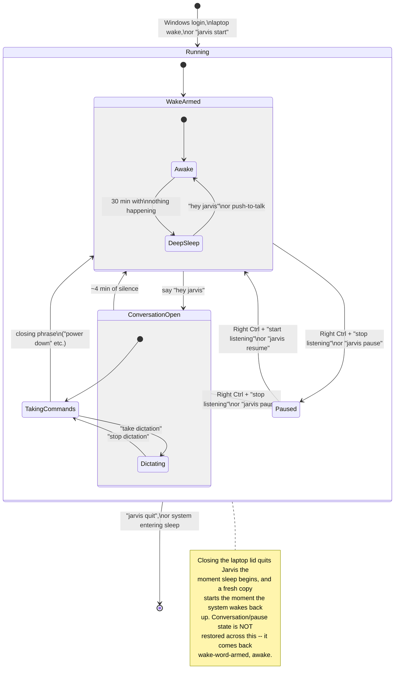

# Jarvis -- User Guide

What you can say to Jarvis, the states it can be in, and the `jarvis`
command line. For the reasoning behind any of this -- real bugs,
measurements, rejected alternatives -- see `DECISIONS.md`; for open
issues and recovery steps, see `KNOWN_LIMITATIONS.md`.

## What you can say

Paraphrasing works -- these are representative, not exhaustive. Anything
unrecognized gets a spoken "not sure how to do that yet" instead of
being ignored, and nothing in the current command set is destructive
(nothing deletes, sends, or closes an app without minimizing first).

**Talking to it**
- "hey jarvis", wait for "Yes, sir?", then speak -- hands-free, for everyday use
- Hold Right Ctrl, speak, let go -- push-to-talk; works in any state, including paused
- "hey jarvis" won't trigger while system audio (music/video/a call) is playing through the speakers -- push-to-talk always works instead, even to control that audio itself
- Hold Right Ctrl while it's talking to cut off a long reply and speak immediately
- An unfamiliar phrasing takes a couple seconds longer (local AI fallback) -- it says "One moment, sir" while it thinks; that's normal, not a hang

**Apps** (Chrome, Discord, VS Code, File Explorer, Settings, D: drive, Windows Terminal, Spotify curated by name; anything else in your Start Menu found automatically)
- "open chrome" / "bring up discord" -- brings it forward if open, launches it otherwise
- "minimize chrome" / "close discord" -- **"close" always means minimize**, never quits an app
- "maximize chrome"
- "how many chrome windows are open" -- counts across every desktop
- Several windows of the same app open? Name what you're after ("the chrome window with the football stream"), or repeat the command within a few seconds to cycle to the next one
- An app that isn't installed/registered gets an honest decline, never a guess

**Desktops**
- "switch to the next/previous desktop" -- next/previous only, no specific numbers
- "snap this window to the left/right" -- Windows' half-screen snap, whatever has focus

**System controls**
- "turn the volume up/down" / "mute"
- "play" / "pause" / "skip this track" / "previous track"
- "lock my computer" -- genuinely locks your screen

**VS Code**
- "switch to the bdk_wallet window in vscode" -- jumps to the open window whose title contains that name

**Read-only questions**
- "how many files are in this folder" -- the currently-focused File Explorer window
- "what's playing" / "what song is this" -- Spotify's current track, or an honest "can't tell" if it's paused or idle

**Screens** (laptop + external monitor)
- "what's on my screen" / "what's on my laptop screen" / "what's on the monitor" -- describes it, grouped by app
- "move this to my laptop screen" / "move this to the monitor" -- moves the focused window there, resized to fit
- Numbered screens ("screen 2") aren't supported -- say "laptop" or "monitor" instead

**Small talk**
- Greetings, "what time is it", "tell me a joke" -- an in-character reply; genuinely offline, so no weather/news/live search, and it says so rather than making something up
- "open chrome" then "minimize it" -- remembers the last app an action touched, for one turn

**Dictation**
- "take dictation" (inside an open conversation) -- types out whatever you say next, word for word, wherever your cursor is
- "stop dictation" to leave it -- **closing phrases get typed while dictating, not obeyed**, so this is the way out by voice (push-to-talk also works normally as an escape hatch)

## States

- **Wake-word armed** -- resting state, listening for "hey jarvis". After 30 idle minutes it quietly drops into **deep sleep** to save memory (still hears the wake word; a couple seconds slower to respond the first time back).
- **Conversation open** -- opened by "hey jarvis", takes any number of commands until a closing phrase ("power down", "we're done", ...) or ~4 minutes of silence closes it.
- **Paused** -- mic fully off, the real privacy control. Only push-to-talk ("stop listening" / "start listening" while holding Right Ctrl) or the command line can set this.
- **Quit** -- not running at all. Closing the window (✕) also stops it, less cleanly than `jarvis quit`.


(GitHub renders this natively; VS Code's Markdown preview needs a Mermaid extension.)

A few things the diagram alone doesn't show:
- Closing/pausing share one word list ("power down", "stop listening", ...); resuming uses a different one ("start listening", "wake up") -- they aren't interchangeable.
- "hey jarvis" never resumes from Paused, with or without Ctrl -- nothing is listening for it in that state. Only Ctrl + a resume word (or `jarvis resume`) works.
- Saying a "stop" word without Ctrl only closes the conversation; the same word with Ctrl pauses entirely, conversation open or not.

| Colour | State |
|---|---|
| Deep red | Armed |
| Cyan | Conversation open |
| Bright cyan, pulsing | Recording |
| Green | Dictating |
| Amber | Thinking (LLM fallback) |
| Near-black | Low power / paused |

## `jarvis` command line

`jarvis <command>`, from anywhere (open a new terminal after first setup):

```
jarvis start           # launch it (auto-starts at login/wake too)
jarvis status          # current state, LLM warm/cold, NO MIC SIGNAL if the mic's dead
jarvis stats           # usage counts, per-stage timings, last 20 utterances
jarvis debug [on|off]  # toggle detailed terminal output, no restart needed
jarvis pause           # mic off, stop listening entirely
jarvis resume          # bring it back
jarvis quit            # stop it completely, with the spoken goodbye
jarvis quit silent     # ...without the goodbye -- used by the sleep-triggered quit
```

`NO MIC SIGNAL` in `status` means the microphone itself has gone dead
(not a Jarvis bug) -- see `KNOWN_LIMITATIONS.md` for recovery steps.
`listener stalled Ns` means restart Jarvis. Everything is also logged to
`logs\session.jsonl` regardless of the `debug` setting.

(`jarvis` forwards to `jarvisctl.py`'s control socket; `jarvisctl.py` can't
launch a fresh instance itself, hence `start` being handled separately.
Long form from `D:\jarvis`: `.venv\Scripts\python.exe jarvisctl.py <command>`.)
